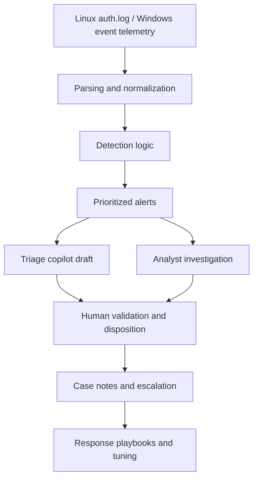

# SentinelTrace — SOC Monitoring, Detection Engineering & AI-Assisted Triage

**A reproducible portfolio lab for entry-level SOC / Security Analyst roles.**

SentinelTrace began as a Python-based Linux SSH authentication log analyzer. The expanded project documents a practical L1 SOC workflow across Linux and Windows telemetry: parse events, detect suspicious patterns, prioritize alerts, investigate evidence, write analyst notes, and keep final decisions under human control.

> **Evidence and scope:** The bundled examples use synthetic training data and documentation-only addresses. The SIEM queries and interactive dashboard alert records are illustrative examples, not exports from a connected Splunk or Microsoft Sentinel workspace. The triage-copilot mock backend is deterministic; its fixture results are not an LLM accuracy score. No production environment, employer telemetry, or client data is involved.

## Project highlights

| Area | Included |
|---|---|
| Python log analysis | Linux OpenSSH parser, authentication detections, JSON/CSV/HTML reporting |
| Detection engineering | Five L1 detection use cases with SPL, KQL, Sigma YAML and ATT&CK mapping |
| Investigation | Three synthetic case walkthroughs with timelines, evidence, verdicts, gaps and escalation notes |
| Response | Three L1 playbooks: brute force, phishing, suspicious script/persistence/process access |
| AI-assisted triage | IOC extraction, strict JSON validation, deterministic mock provider, optional local Ollama adapter |
| Governance | Human approval, audit log, untrusted-input guidance, model limitations and evaluation boundary |

## Architecture



## Detection catalogue

| Rule | Behavior | Main telemetry | ATT&CK | Default severity |
|---|---|---|---|---|
| ST-DET-01 | Repeated authentication failures followed by success | SSH auth.log; Windows 4625/4624 | T1110.001 | High / Critical |
| ST-DET-02 | New local account creation | Windows Security 4720; group events 4732/4728 | T1136.001 | High |
| ST-DET-03 | Encoded PowerShell execution | Sysmon 1; PowerShell 4104; Security 4688 | T1059.001 | High |
| ST-DET-04 | Scheduled task creation | Security 4698; Sysmon 1 / schtasks.exe | T1053.005 | Medium / High |
| ST-DET-05 | Unusual process access to LSASS | Sysmon 10 | T1003.001 | High |

See [`docs/detections/detection-catalog.md`](docs/detections/detection-catalog.md), [`splunk/`](splunk/), [`kql/`](kql/), and [`sigma/`](sigma/). Queries are examples and must be adapted and validated against actual data sources and field mappings.

## Original Python SSH analyzer

The original analyzer reads supported Linux OpenSSH authentication messages and can identify:
- repeated failed SSH authentication attempts from one source;
- successful SSH authentication after a failure burst;
- successful remote SSH login to the root account.

It exports JSON, CSV, summary JSON, and a standalone HTML report.

```powershell
py -3 src\sentineltrace.py data\sample_auth.log --out outputs\ssh
```

The existing repository documentation describes a sample with 8 synthetic events and 3 alerts. Run the command above in the cloned repository to reproduce the result on the local machine.

## Triage copilot

The new Python prototype:
- extracts IP-like values, domains, and hashes from selected alert fields without external enrichment;
- generates constrained JSON draft suggestions;
- validates exact keys, allowed verdicts, confidence range, and list fields;
- supports a deterministic mock backend and optional local Ollama adapter;
- generates Markdown triage notes;
- supports interactive human review and JSONL decision logging.

Run the mock example:

```powershell
py -3 src\triage_copilot.py data\triage_eval_30.json --backend mock --out outputs\copilot_demo
py -3 scripts\evaluate_copilot.py data\triage_eval_30.json --out outputs\copilot_eval
```

To use a locally running Ollama model, first verify that Ollama is running and the selected model is already available:

```powershell
ollama list
py -3 src\triage_copilot.py data\triage_eval_30.json --backend ollama --model YOUR_LOCAL_MODEL --out outputs\ollama_demo
```

No model is downloaded by SentinelTrace. The model output is a draft only; a human analyst must validate evidence and choose the final disposition.

## Reproducible tests

```powershell
py -3 -m unittest discover -s tests -v
```

The extension's triage-copilot tests were run in the build workspace: **7 passed**. The synthetic 30-alert mock fixture produced 30 schema-valid suggestions, with 10 suggestions in each of the three verdict categories. Its 30/30 fixture match is a deterministic plumbing check, not an LLM accuracy metric or production performance claim. See [`docs/execution-results.md`](docs/execution-results.md).

## Investigations and response playbooks

- [`docs/investigations/01-ssh-brute-force-to-success.md`](docs/investigations/01-ssh-brute-force-to-success.md)
- [`docs/investigations/02-windows-persistence-chain.md`](docs/investigations/02-windows-persistence-chain.md)
- [`docs/investigations/03-phishing-and-pcap-analysis.md`](docs/investigations/03-phishing-and-pcap-analysis.md)
- [`docs/playbooks/brute-force-response.md`](docs/playbooks/brute-force-response.md)
- [`docs/playbooks/phishing-response.md`](docs/playbooks/phishing-response.md)
- [`docs/playbooks/suspicious-execution-response.md`](docs/playbooks/suspicious-execution-response.md)

The investigation walkthroughs are synthetic learning scenarios. The PCAP walkthrough is a worksheet-style example; no actual capture file is bundled or claimed as analyzed.

## Repository layout

```text
SentinelTrace/
├── README.md
├── src/
│   ├── sentineltrace.py
│   └── triage_copilot.py
├── data/
│   ├── sample_auth.log
│   └── triage_eval_30.json
├── tests/
│   ├── test_sentineltrace.py
│   └── test_triage_copilot.py
├── scripts/
│   └── evaluate_copilot.py
├── dashboards/
│   ├── index.html
│   ├── styles.css
│   └── dashboard.js
├── splunk/
├── kql/
├── sigma/
├── docs/
│   ├── detections/
│   ├── investigations/
│   ├── playbooks/
│   ├── copilot-design.md
│   ├── copilot-evaluation.md
│   ├── execution-results.md
│   └── resume-linkedin-interview-kit.md
└── outputs/
    ├── copilot_demo/
    ├── copilot_eval/
    └── illustrative-siem/
```

## Interactive SOC dashboard

A responsive, static dashboard is included in [`dashboards/`](dashboards/). It reads the repository's own SIEM example alerts, mock copilot suggestions, mock evaluation summary, and original SSH sample log. It includes searchable/filterable tables, record-detail drawers, an SSH timeline, severity and verdict visualizations, and filtered CSV export. No backend, API key, npm install, or paid service is required.

Run locally from the repository root:

```powershell
py -m http.server 8000
```

Open `http://localhost:8000/dashboards/`. For public access, enable GitHub Pages from the default branch and repository root; the dashboard will be available at `https://gutnukusandhyarani.github.io/SentinelTrace/dashboards/` after the Pages deployment completes. See [`docs/dashboard-guide.md`](docs/dashboard-guide.md) for the source-file map and deployment instructions.

**Dashboard evidence note:** totals are read from version-controlled sample files. The SIEM queue is illustrative, while the copilot suggestions and fixture metrics come from the deterministic mock backend. None of these are live SIEM alerts or an LLM accuracy benchmark.

## Limitations and next steps

- SIEM SPL/KQL examples have not been executed against an actual Splunk or Microsoft Sentinel workspace in this build.
- Sigma YAML syntax was parsed locally; backend conversion and detection behavior still need platform validation.
- The optional Ollama adapter is implemented but requires a local Ollama service and an installed model; model performance has not been measured here.
- IOC extraction is offline pattern matching; it does not establish reputation, ownership, maliciousness, or geolocation.
- Synthetic fixtures are not representative of real enterprise event distributions.
- The mock copilot does not execute commands or perform automated containment.
- Production use would require access control, privacy review, secure ingestion, retention, monitoring, change management, and analyst approval.

## Portfolio statement

**SentinelTrace demonstrates** Python security-log analysis, entry-level detection engineering, MITRE ATT&CK mapping, SPL/KQL/Sigma authoring, incident triage, structured investigation notes, false-positive thinking, playbook writing, and safe AI-assisted analyst workflows.

Only describe SIEM rules as deployed/tested after personally running them in an authorized lab. Only describe Ollama behavior after running the selected model and reviewing its outputs.
