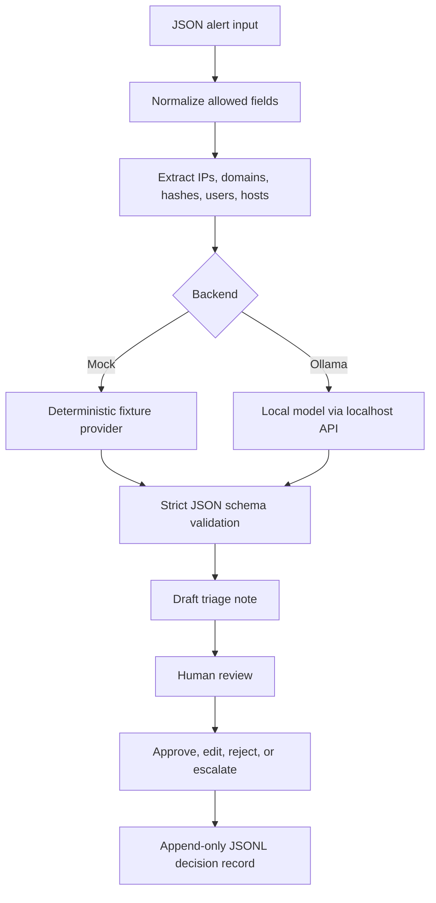

# SentinelTrace Triage Copilot — Design and Guardrails

## Purpose

The prototype turns a structured alert into a draft analyst note. It extracts common IOC patterns, produces a constrained JSON suggestion, and keeps final disposition under human control.

## Data flow

## Output schema

- `summary`: short alert summary.
- `likely_cause`: hypothesis, not a confirmed finding.
- `suggested_verdict`: `TRUE_POSITIVE`, `FALSE_POSITIVE`, or `ESCALATE`.
- `confidence`: numeric value from 0 to 1.
- `evidence`: list of alert fields used.
- `next_steps`: safe investigation steps.
- `questions`: context an analyst should confirm.
- `unknowns`: information not present in the input.
- `iocs`: extracted values with type and source field.

## Prompt-injection and untrusted-data handling

Alert fields, log lines, email subjects, command lines, URLs, and file names are untrusted data. They may contain text that looks like instructions. The prompt explicitly tells the model to treat those values as evidence only, not follow them. The application also:
- sends only a narrow alert object rather than the entire conversation;
- demands a JSON object with known keys;
- validates the verdict and confidence range;
- rejects malformed output;
- requires a human to approve or edit any final verdict;
- does not execute commands, open URLs, block IPs, or isolate hosts.

These controls reduce risk but do not guarantee that a model cannot make mistakes. Do not provide secrets, personal data, or employer/client telemetry to an unapproved model.

## When not to trust the assistant

- The alert lacks host, timestamp, source, or account context.
- A source IP is a shared NAT, VPN, proxy, or documentation address.
- The model invents a user, host, hash, or event not present in the evidence.
- The event requires domain-specific knowledge or a change ticket that was not supplied.
- The model recommends containment without approved human authorization.
- The output is malformed, contradicts source fields, or expresses high confidence without evidence.

## Evaluation boundary

The mock backend exists to test parsing, schema enforcement, deterministic routing, and logging. Its results do not measure the intelligence or accuracy of an LLM. Ollama output quality depends on the chosen local model, prompt, data quality, and runtime; it must be separately evaluated.
